# DSO202 Assignment 3: Multi-Tier Application Deployment Using Kustomize and Helm

---

## 1. Executive Summary & Architecture Overview

This technical report documents the design, implementation, diagnostic lifecycle, and functional verification of a three-tier TODO microservices application deployed on Kubernetes. The objective of this assignment is to master and compare two Kubernetes configuration management tools: **Kustomize** (declarative template-free customization) and **Helm** (package-based dynamic templating).

### Architecture Stack

The application uses a three-tier architecture:

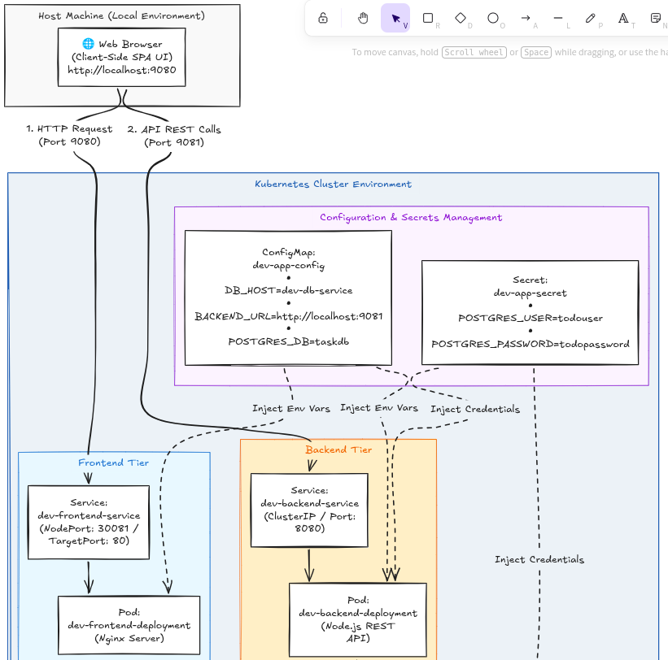
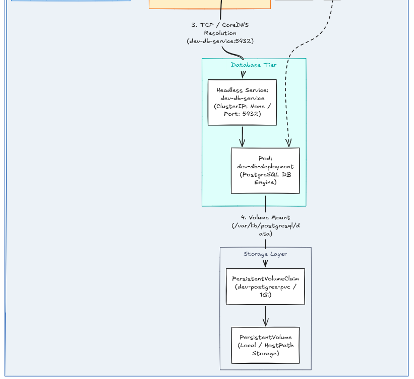

1. **Frontend Tier**: Nginx web server rendering a single-page application (SPA).
2. **Backend Tier**: Node.js REST API service (`02230290namgay/dso202-backend:1.0`) handling data persistence requests.
3. **Database Tier**: PostgreSQL relational database bound to a `PersistentVolumeClaim` (PVC) for data durability.
4. **Configuration & Secrets**: `ConfigMaps` manage service hostnames and API endpoints, while `Secrets` store database credentials.

---

## 2. Theoretical Foundations

### 2.1 Declarative Overlays (Kustomize) vs. Dynamic Packaging (Helm)

* **Kustomize (Base/Overlay Model)**: Uses standard, un-templated Kubernetes YAML files. A central **Base** holds common definitions, while **Overlays** apply patches and prefixes (`namePrefix`) for environment-specific deployment (`dso202-dev`, `dso202-prod`).
* **Helm (Templating Engine)**: Packages resources into a **Chart** using Go templates (`templates/`). Parameter values are injected dynamically via `values.yaml` or command-line flags, providing version control, release history tracking, and one-command rollbacks.

### 2.2 Pod Networking, CoreDNS, and Browser API Ingress

Kubernetes pods communicate internally using CoreDNS hostnames (e.g., `dev-db-service.dso202-dev.svc.cluster.local`). However, web-based single-page applications run client-side inside the user's web browser on the host machine. As a result, API requests destined for the backend must be exposed to the host machine (e.g., via `kubectl port-forward` or `NodePort`), while backend-to-database communication remains within the internal cluster network.

---

## 3. Comprehensive Implementation & Diagnostic Evidence Log

### Part 1: Kustomize Base/Overlay Manifest Inspection & Cluster Setup

#### Manifest Dry-Run Generation (`k kustomize kustomize/overlays/dev/`)

The Kustomize dev overlay generates environment-specific manifests with auto-generated content hashes.

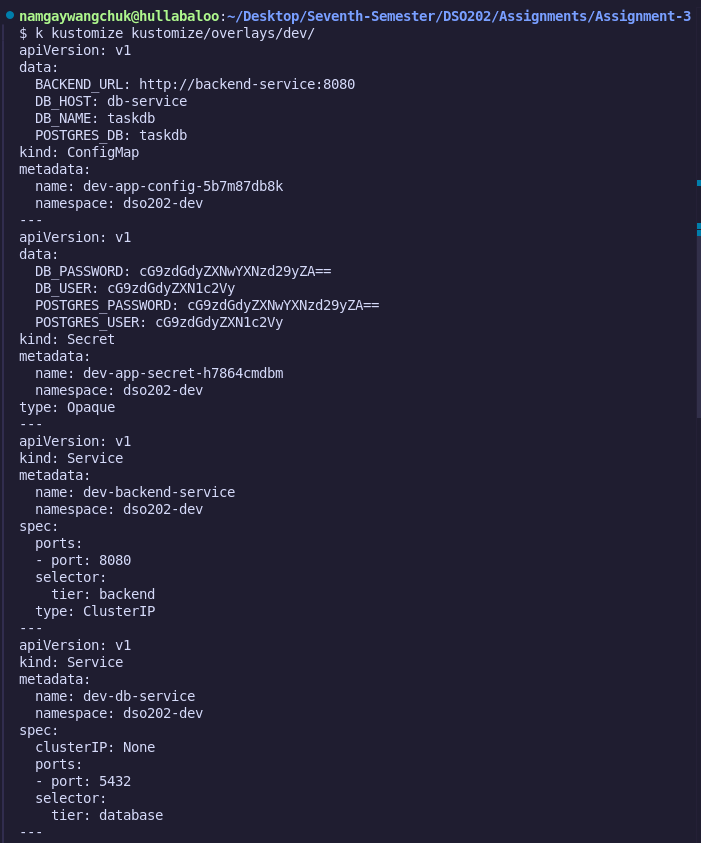
*Figure 1.1: Generated ConfigMap with hashed name `dev-app-config-5b7m87db8k`, Secret `dev-app-secret-h7864cmdbm`, `dev-backend-service`, and headless `dev-db-service`.*

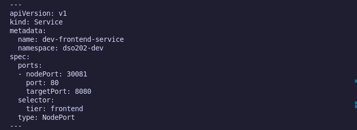
*Figure 1.2: `dev-frontend-service` configured as NodePort on port `30081` mapping to container port `80`.*

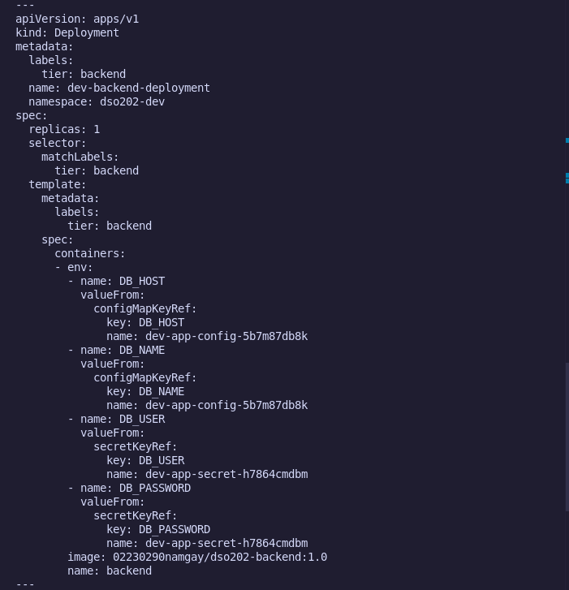
*Figure 1.3: `dev-backend-deployment` referencing hashed ConfigMap and Secret keys for database connectivity.*

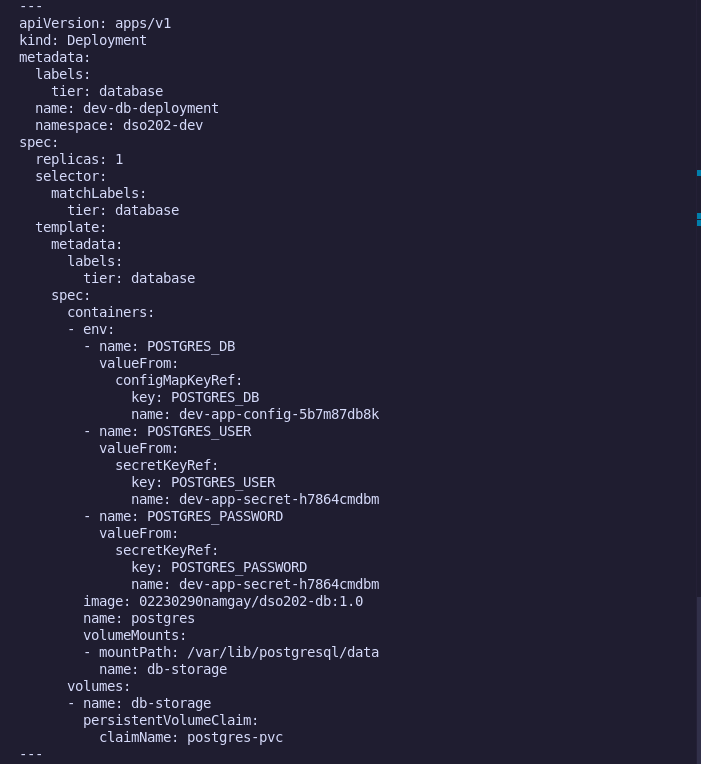
*Figure 1.4: `dev-db-deployment` mounting `postgres-pvc` at `/var/lib/postgresql/data`.*

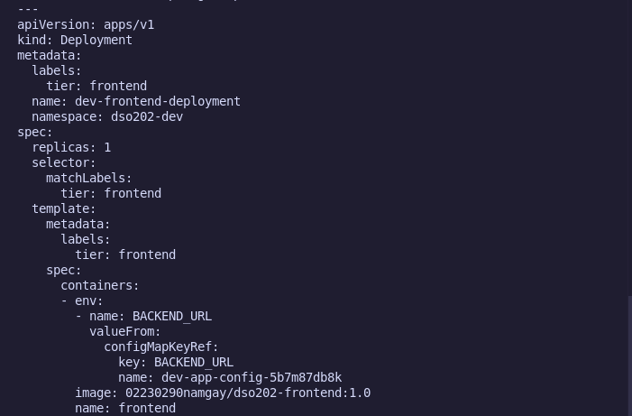
*Figure 1.5: `dev-frontend-deployment` referencing `BACKEND_URL` from ConfigMap `dev-app-config-5b7m87db8k`.*

#### Initial Namespace Creation & Overlay Deployment

Isolation across development and production environments is established by creating separate namespaces.

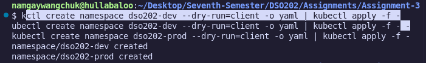
*Figure 1.6: Declarative creation of `dso202-dev` and `dso202-prod` namespaces using `kubectl apply`.*

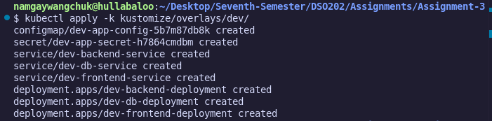
*Figure 1.7: Applying dev overlay via `kubectl apply -k kustomize/overlays/dev/`.*

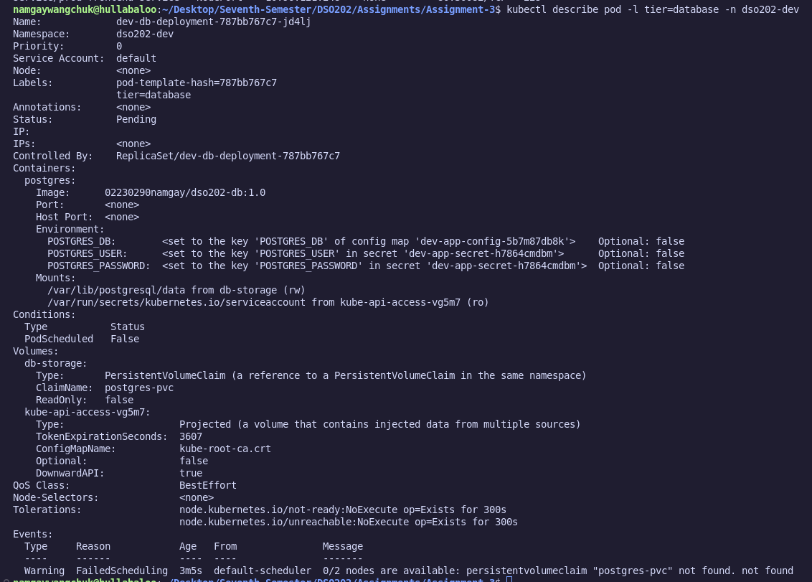
*Figure 1.8: NodePort conflict during prod overlay deployment: `spec.ports[0].nodePort: Invalid value: 30081: provided port is already allocated`.*

---

### Part 2: Troubleshooting Storage, DNS, and Connection Errors

#### Storage Claim Resolution

During initial deployment, database pods remained in a `Pending` state due to missing storage claims.

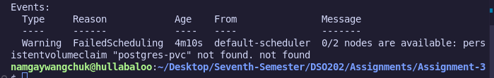
*Figure 1.9: Diagnostic output showing database pods stuck in `Pending` state (`0/1 READY`).*

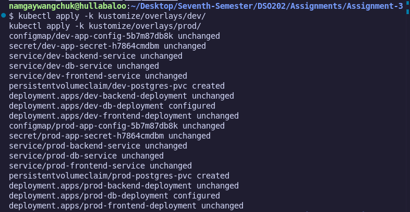
*Figure 1.10: `kubectl describe pod` showing scheduling error: `persistentvolumeclaim "postgres-pvc" not found`.*

*Figure 1.12: Applying updated manifests containing PVC definitions (`dev-postgres-pvc` and `prod-postgres-pvc`).*

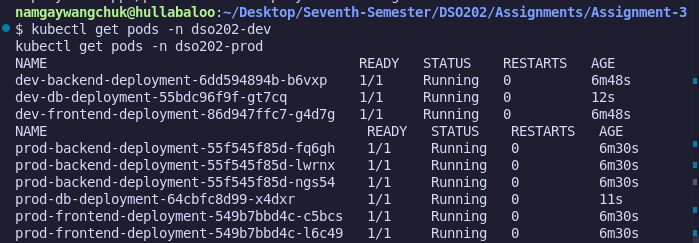
*Figure 1.13: Workload health check confirming all pods `Running` across `dso202-dev` and `dso202-prod`.*

#### Resolving `ENOTFOUND` & ConfigMap Synchronization

Although pods entered a `Running` state, backend logs reported continuous database lookup failures.

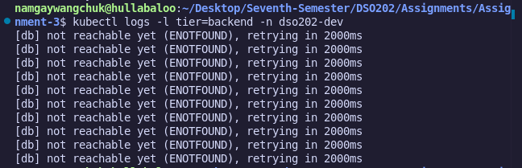
*Figure 1.14: Backend logs showing repeating `[db] not reachable yet (ENOTFOUND)` errors.*

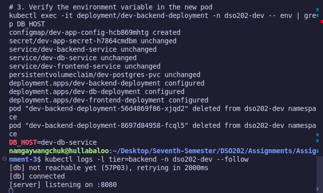
*Figure 1.15: Updating `DB_HOST=dev-db-service`, recreating backend pods, and confirming successful connection: `[db] connected` and `[server] listening on :8080`.*

* **Root Cause**: Kustomize's `namePrefix: dev-` changed the database service name to `dev-db-service`, but the ConfigMap retained the default value `DB_HOST=db-service`.
* **Fix**: Updated `DB_HOST` to `dev-db-service` in the ConfigMap generator and deleted the running backend pod to force it to re-read the updated configuration.

---

### Part 3: Port Forwarding & Browser API Routing

#### Port Conflicts & Local Listener Selection

Connecting the client-side browser interface required forwarding local ports to the cluster services.

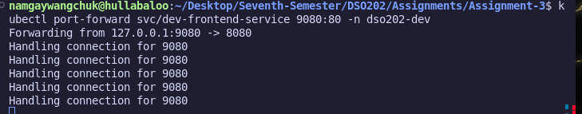
*Figure 1.17: Forwarding `dev-frontend-service` from local port `9080` to container port `80`.*

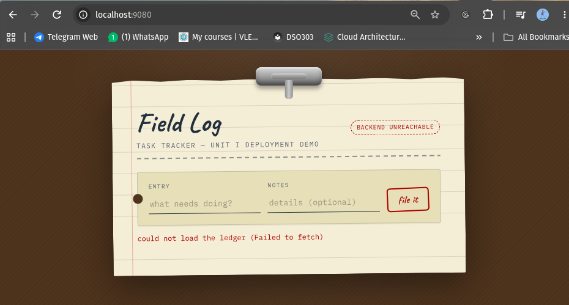
*Figure 1.19: SPA UI displaying `BACKEND UNREACHABLE` prior to aligning local port bindings.*

*Figure 1.20: Secondary port conflict attempt on default API port `8080`.*

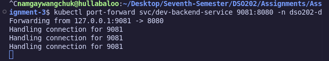
*Figure 1.21: Establishing dedicated backend API forwarding on `127.0.0.1:9081 -> 8080`.*

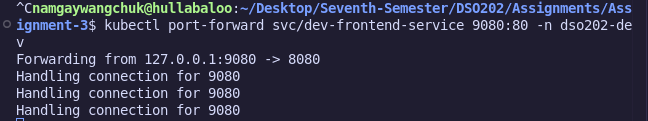
*Figure 1.22: Establishing dedicated frontend forwarding on `127.0.0.1:9080 -> 80`.*

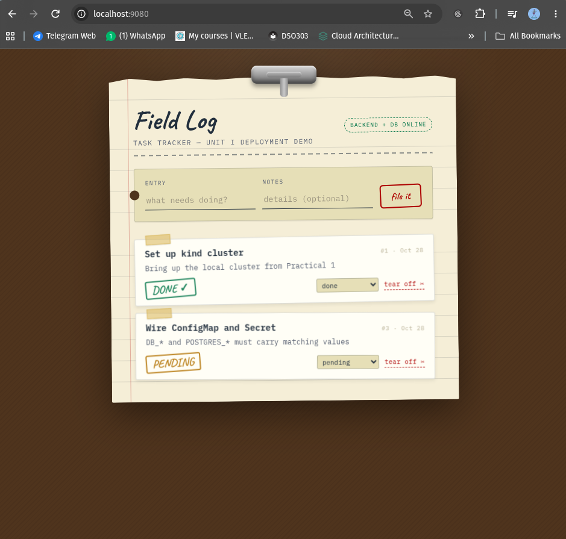

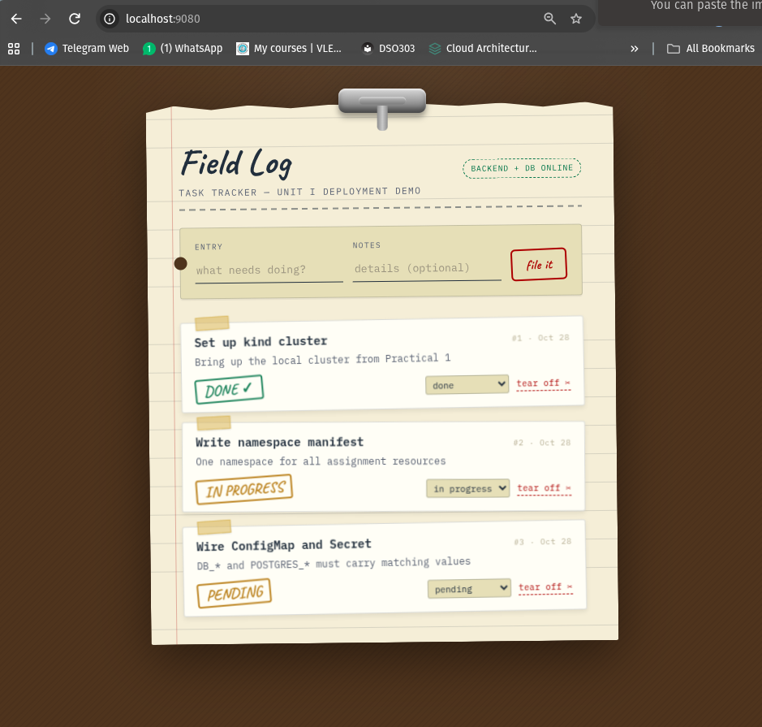
*Figure 1.23: Final web UI displaying status `BACKEND + DB ONLINE` with task creation and persistent storage verified.*

---

### Part 4: Helm Chart Packaging, Validation & Lifecycle Management

#### Chart Creation & Schema Linting Resolution

Package management was implemented using a custom Helm chart (`helm/todo-app/`).

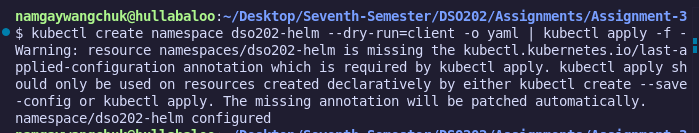
*Figure 1.24: Creating the target `dso202-helm` namespace.*

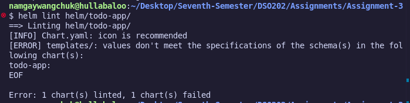
*Figure 1.25: Initial `helm lint` failure due to schema validation error (`EOF`).*

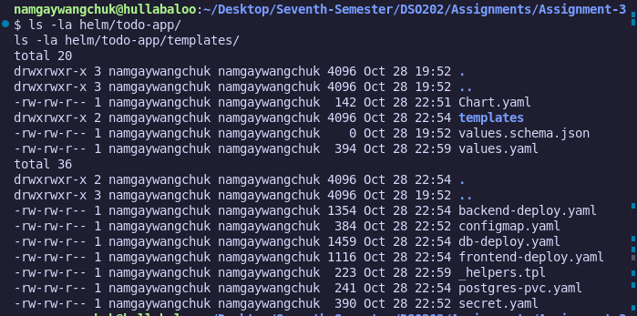
*Figure 1.27: Inspecting chart directory tree and locating an unpopulated `values.schema.json` file (0 bytes).*

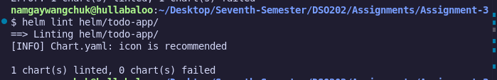
*Figure 1.28: Successful lint execution (`0 chart(s) failed`) after removing the empty schema file.*

#### Helm Template Dry-Run Verification (`helm template`)

Manifest rendering was verified using `helm template` prior to installation.

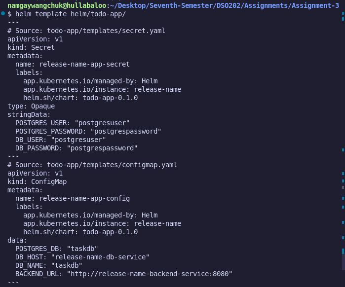
*Figure 1.29: Rendered Secret and ConfigMap resources displaying interpolated release parameters.*

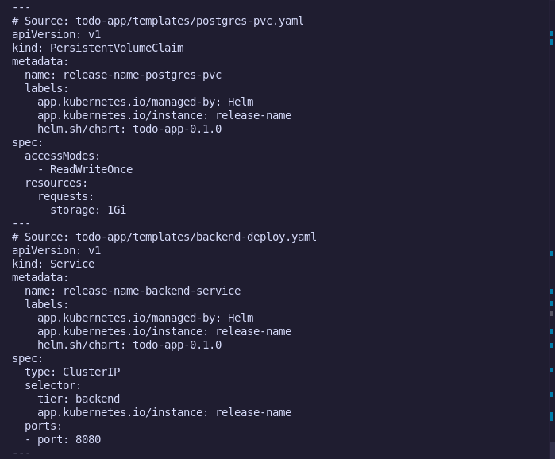
*Figure 1.30: Rendered `PersistentVolumeClaim` (1Gi storage request) and backend `ClusterIP` Service.*

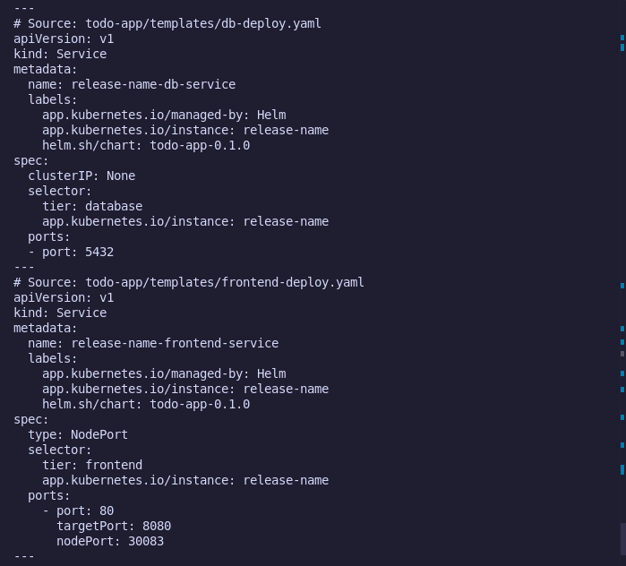
*Figure 1.31: Rendered headless database Service and NodePort frontend Service (port `30083`).*

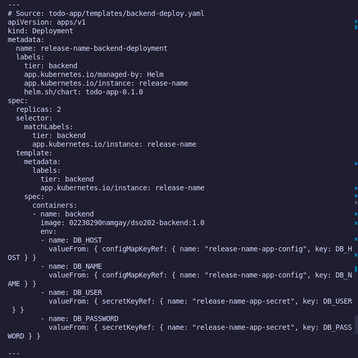
*Figure 1.32: Rendered backend Deployment manifest configured for 2 replicas.*

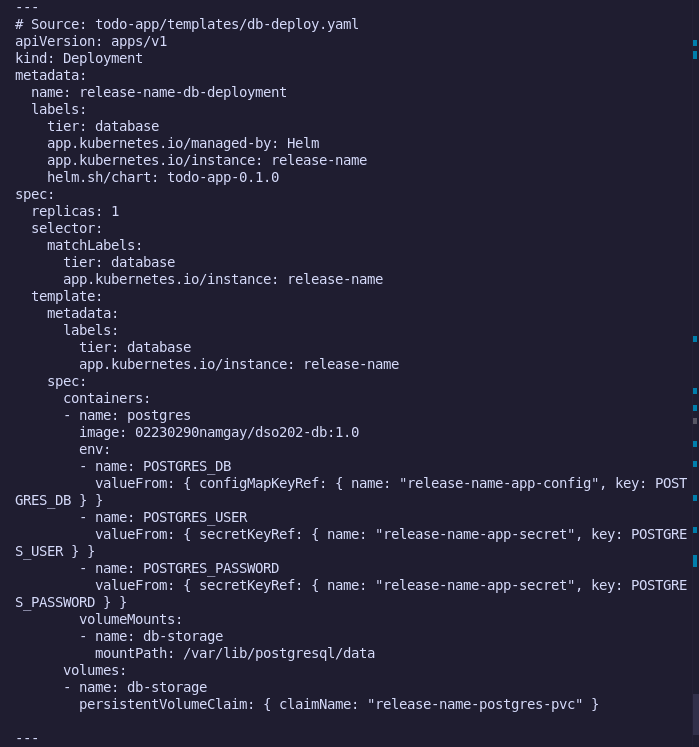
*Figure 1.33: Rendered database Deployment manifest with persistent storage volume mounts.*

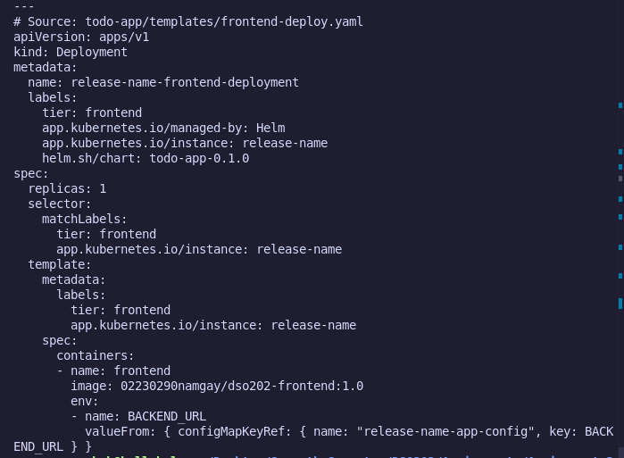
*Figure 1.34: Rendered frontend Deployment manifest referencing `BACKEND_URL`.*

#### Deployment Lifecycle, Dynamic Scaling & Rollback

The chart was installed, scaled dynamically, and rolled back using Helm's release management commands.

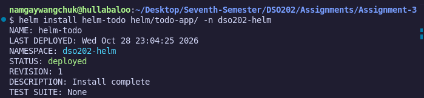
*Figure 1.35: Deploying chart release `helm-todo` into `dso202-helm` (Revision 1).*

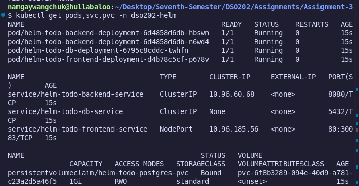
*Figure 1.36: Verifying active pods, services, and bound storage status in `dso202-helm`.*

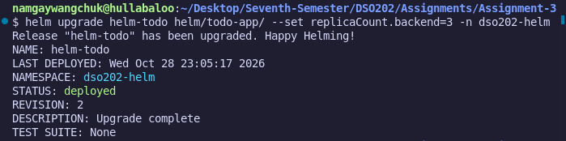
*Figure 1.37: Scaling backend replicas to 3 using `helm upgrade --set replicaCount.backend=3` (Revision 2).*

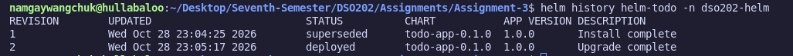
*Figure 1.38: Inspecting release history via `helm history helm-todo`.*

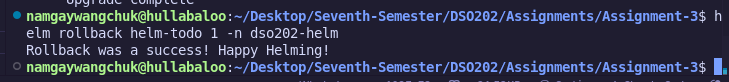
*Figure 1.39: Rolling back release to Revision 1 via `helm rollback helm-todo 1`.*

---

## 4. Key Technical Challenges & Resolution Matrix

| # | Diagnostic Issue | Root Cause | Resolution Strategy | Evidence |
| --- | --- | --- | --- | --- |
| **1** | NodePort conflict on `prod` deployment | Both overlays inherited `nodePort: 30081` from base. | Reconfigured `prod` overlay to use port `30082`. | *Figure 1.8* |
| **2** | Database Pod stuck in `Pending` state | Deployment requested `postgres-pvc`, which was missing. | Added `pvc.yaml` to base resources and aligned prefix references. | *Figures 1.10–1.12* |
| **3** | `ENOTFOUND` backend connection retries | `DB_HOST` in ConfigMap was set to `db-service` instead of `dev-db-service`. | Updated ConfigMap generator to `dev-db-service` and recreated the backend pod. | *Figures 1.14–1.15* |
| **4** | `BACKEND UNREACHABLE` UI error | Web browser on host machine could not resolve internal cluster IP addresses. | Forwarded backend API port to `localhost:9081` and updated `BACKEND_URL`. | *Figures 1.19, 1.21* |
| **5** | Sockets binding errors (`bind: address already in use`) | Host ports `8080` and `9081` were occupied by background processes. | Mapped host ports (`9080` for frontend, `9081` for backend). | *Figures 1.16, 1.21, 1.22* |
| **6** | `helm lint` schema parsing failure | Empty `values.schema.json` file (0 bytes) caused an EOF error. | Removed the empty schema file, allowing lint checks to pass. | *Figures 1.25, 1.28* |

---

## 5. Architectural Comparison & Conclusion

### Kustomize vs. Helm Comparison

* **Kustomize**: Best suited for declarative, template-free configuration management across static environments (`dev`/`prod`). It relies entirely on standard YAML structures, avoiding the complexity of template rendering logic.
* **Helm**: Ideal for dynamic application lifecycle management, versioning, and packaging. It allows parameter injection via `values.yaml`, simplifies variable-driven scaling, and provides built-in release history tracking and rollbacks.

### Final Verification

The three-tier TODO application was deployed, configured, and verified across both Kustomize and Helm environments. By resolving storage claim references, internal DNS hostnames (`dev-db-service`), and local port forwarding rules (`localhost:9080` and `localhost:9081`), the application achieved full functional verification: task items persist reliably in PostgreSQL and render correctly in the web UI.